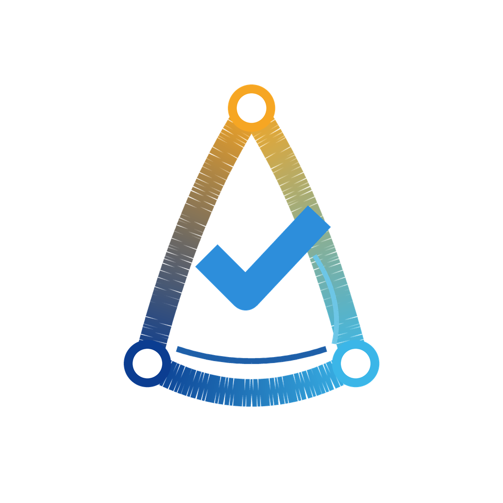

# 또니랑

**[RC1 최소 R8 내려받기](https://github.com/tongosu/ddonilang/releases/tag/v1.0.0-rc.1) · [시작 안내](START_HERE.md) · [알려진 제한](RC1_KNOWN_LIMITATIONS.md)**

**한국어로 생각하고, 정확하게 표현하고, 만든 세계를 다시 확인하는 언어**

또니랑은 초등학교 6학년이던 2025년 12월, 졸업 과제로 시작했습니다.

처음에는 Scratch와 Snap!으로 프로그래밍을 배웠고, 그 뒤 Python을 공부했습니다. 프로그램으로 할 수 있는 일은 많았지만, 배우면서 이런 생각이 들었습니다.

**왜 수학이나 게임은 한국어로 생각하면서, 프로그램을 만들 때는 다시 다른 방식으로 생각해야 할까?**

그래서 한국어로 자연스럽게 생각을 표현하면서 게임도 만들고 공부도 할 수 있는 프로그래밍 언어를 직접 만들어 보기로 했습니다.

처음에는 작은 졸업 과제였습니다. 하지만 만들다 보니 문법, 수학, 결정성, 게임, AI에 대한 질문이 계속 늘어났습니다. 지금은 시험판을 만들고 다듬으면서, 실제로 사용할 수 있는 흐름을 하나씩 완성하고 있습니다.

## 개발 현황

V2 비공개 후보·V3 첫 탐구노트·V4 첫 조건부 풀이 단계·V5 첫 로봇은 각각 고정 범위의 내부 한정 검토를 마쳤습니다. 전체 버전 완성이나 Human·공개 완료와는 다릅니다. V6~V9는 후속 계획 후보입니다.

[2026-10-31 개발·계약 갱신](publish/development/UPDATES_20261031.md) · [현재 개발·지원 범위](publish/development/STATUS.md) · [개발 소스 빌드와 제외 범위](publish/development/BUILD_SOURCE.md)

## 한국어로 생각하는 언어

또니랑에서는 한국어의 어순과 조사, 어미 같은 특징을 프로그래밍에 활용하려고 합니다.

조사는 입력의 역할을 드러내고, 이름과 활용형은 정의와 호출을 연결합니다. 계산하는 **셈씨**와 세계를 바꾸는 **움직씨**를 구분하고, 의미를 정의하는 일과 값을 결속하거나 다시 결속하는 일도 나눴습니다.

이런 문법을 정하면서 계속 고민한 것은 두 가지였습니다.

**사람이 자연스럽게 읽을 수 있는가? 컴퓨터가 한 가지 뜻으로 정확하게 해석할 수 있는가?**

읽기 편하다는 이유로 컴퓨터가 문맥을 마음대로 추측하게 하고 싶지는 않았습니다. 허용하는 표현과 그 뜻을 명확히 정하고, 모호하면 알려 주도록 만들려고 합니다.

먼저 한국어를 제대로 다룬 뒤, 일본어처럼 비슷한 특징을 가진 다른 교착어에도 이 방법을 넓혀 보고 싶습니다. 단어를 번역하는 것을 넘어, 각 언어로 생각하고 표현하는 방식에 맞는 프로그래밍을 연구하려는 것입니다.

## 수학을 계산하고, 풀고, 증명하기

또니랑에서는 수학도 중요합니다.

함수, 벡터, 행렬, 단위와 물리량을 우리가 배우는 모습에 가깝게 표현하고 싶습니다. 답을 계산하는 데서 끝내지 않고, 풀이 과정을 따라가고, 식을 바꾸고, 그림으로 확인하고, 왜 맞는지 증명하는 과정까지 연결하는 것이 목표입니다.

그래서 여러 수학 표현과 증명 방법도 연구하고 있습니다. 다만 연구한 내용과 실제로 실행할 수 있는 기능은 구분합니다. 수학 증명과 고급 수학 기능 전체가 이미 완성된 것은 아닙니다.

## 같은 조건에서는 같은 결과

가장 중요하게 생각하는 원칙 중 하나는 **결정성**입니다.

같은 프로그램을 같은 시작 상태, 실행 조건과 입력으로 실행했다면 같은 결과를 다시 만들 수 있어야 합니다. 그래야 과학 실험을 비교하고, 게임의 문제를 재현하고, 여러 AI를 같은 조건에서 시험할 수 있습니다.

이를 위해 세계의 상태, 세계를 바꾸는 규칙, 외부 입력, 화면에 보여 주는 표현과 기록의 역할을 구분하려고 합니다. 누리, 이야기, 보개, 샘, 거울 같은 개념도 이러한 구분과 연결됩니다.

카메라를 움직였다고 게임 속 세계가 달라지거나, 그래프의 표시 방법을 바꿨다고 계산 결과가 달라져서는 안 된다고 생각합니다.

아직 모든 기능과 모든 플랫폼에서 완전히 같은 결과를 재현하는 것은 아닙니다. 이 원칙을 실제 제품에서도 지키도록 계속 구현하고 검증하고 있습니다.

## Rust를 몰랐지만 AI와 도전했습니다

저는 Python은 공부했지만 Rust는 아직 잘 모릅니다. 그래도 원하는 결정적 실행환경을 만들기 위해 Rust를 선택하고, AI의 도움을 받아 도전했습니다.

Rust를 쓴다고 결정성이 저절로 생기는 것은 아닙니다. 수를 어떻게 표현할지, 입력을 어떻게 받아들일지, 상태와 실행 기록을 어떻게 연결할지를 따로 설계해야 했습니다.

실제 구현 코드의 대부분은 AI가 작성합니다. 저는 만들고 싶은 기능과 방향을 정하고, AI에게 설명하고, 여러 방법 중 하나를 고르고, 결과를 실행해 봅니다. 생각과 다르면 다시 설명하고 고칩니다.

이렇게 개발하면서 AI의 설명이 그럴듯하더라도 제가 원하는 뜻과 다를 수 있다는 것을 경험했습니다. 문서에 있는 기능과 실제로 실행되는 기능이 다르기도 했습니다.

그래서 AI에게 답을 받는 것뿐 아니라, **그 답의 근거와 실제 동작을 확인하는 일**이 중요해졌습니다.

## 커진 프로젝트를 정리하는 과정

개발이 커지면서 코드, 연구 자료, 제안, 테스트와 공개 자료가 뒤섞여 관리가 어려워졌습니다.

그래서 내부 개발판과 공개판을 나누게 됐습니다. 내부에서는 진행 중인 연구와 개발 기록을 관리하고, 공개판에서는 다른 사람이 읽고 이해할 수 있는 코드와 소개, 스펙과 예제를 구분해 정리하려고 했습니다.

GitHub도 개발 내용을 공개하고 다른 사람에게 설명하는 통로로 사용하고 있습니다.

또한 문법과 의미의 기준을 정본으로 기록하고, 제안·승인·구현·검토 상태를 나눠 관리하게 됐습니다. 설계에 적혀 있다는 이유만으로 제품이 완성됐다고 말하지 않기 위해서입니다.

현재 공개 Language SPEC은 **v0.8.1**입니다. 내부 설계 정본과 공개 언어 스펙, 실제 제품의 버전과 지원 범위는 서로 구분합니다.

## AI는 ‘슬기’

또니랑에서는 AI를 **슬기**라고 부릅니다.

AI가 내놓은 제안과 프로그램의 규칙으로 확정한 뜻을 구분하고 싶었기 때문입니다. 슬기는 사람과 함께 프로그램을 만들 수 있지만, 프로그램의 뜻을 마음대로 정하지는 않습니다.

장기적으로는 또니랑에서 AI를 만들고, AI와 함께 프로그램을 짜고, 여러 AI를 같은 조건에서 시험하는 일까지 해 보고 싶습니다.

## 또니랑으로 만들고 싶은 것

### 셈그림

**셈그림**은 또니랑으로 계산한 것과 만든 세계를 눈으로 보고 직접 바꿔 보는 도구입니다.

함수와 도형을 움직여 보고, 과학 실험의 조건을 바꾸고, 경제 모형의 변화를 살펴보고, 역사 속 지도와 사건을 따라가고 싶습니다. 누나가 경제학을 좋아해서 경제도 함께 넣어 보고 싶었습니다.

제가 만들고 싶은 셈그림은 **배운 내용을 직접 바꾸고, 움직이고, 실험할 수 있는 교과서**에 가깝습니다.

### 말힘누리와 그날

**말힘누리**와 **그날**이라는 게임 프로젝트도 만들고 있습니다.

게임을 만들면 이동, 지형, 전투, 저장과 많은 개체의 움직임 같은 구체적인 문제가 생깁니다. 이런 문제를 풀면서 또니랑이 세계와 게임을 어떻게 표현해야 할지도 공부하고 있습니다.

특히 그날에서는 역사 속 사건과 전투를 게임으로 다루면서 역사, 지리, 수학, 과학과 프로그래밍을 함께 배워 보고 싶습니다.

### NuriGym

게임과 AI를 함께 생각하면서 또 다른 질문이 생겼습니다.

**사람이 플레이하는 세계와 AI가 배우는 세계를 꼭 따로 만들어야 할까?**

장기적으로 만들고 싶은 **NuriGym**은 같은 세계에서 사람이 플레이하고, AI가 관찰하고 행동하며 배우고, 여러 AI를 같은 조건에서 시험하는 환경입니다. 결과를 기록하고 다시 확인하는 것까지 연결하려고 합니다.

## 또니랑을 만들며 저도 배우고 있습니다

자료형, 함수, 제네릭, 메타프로그래밍, 모듈, 상태기계, 오류 처리와 시뮬레이션을 공부하면서 또니랑에서는 어떻게 표현하면 좋을지 생각합니다.

문법을 외우는 것과 함께, **“프로그래밍 언어는 왜 이렇게 만들어졌을까?”**를 생각할 수 있는 언어가 되었으면 좋겠습니다.

한국어로 생각을 쓰고, 수학으로 표현하고, 결정적으로 실행한 세계를 셈그림에서 관찰하고, 게임과 AI 실험으로 넓히는 일은 하나로 이어집니다.

## 처음 배우고, 오래 사용하는 언어

또니랑은 아직 개발 중입니다. 기본 문법과 여러 실행 기능을 만들었지만, 문서에 있는 모든 기능이 지금 실행되는 것은 아닙니다. 게임 제작 환경과 고급 수학, 증명, NuriGym 등은 계속 연구하고 개발하고 있습니다.

초등학교 졸업 과제로 시작한 작은 프로젝트이지만, 여기서 끝내고 싶지는 않습니다.

제가 Scratch로 프로그래밍을 처음 배웠던 것처럼, 누군가는 또니랑으로 처음 프로그래밍을 배우고, 중학교와 고등학교에서는 수학과 과학을 공부하고 게임을 만들고, 대학과 연구에서도 계속 사용할 수 있었으면 좋겠습니다.

**처음 배우기 쉬운데, 배울수록 버릴 필요가 없는 언어.**

그것이 또니랑으로 만들고 싶은 것입니다.

## 지금 실행해 보기

공개 RC1은 Windows x64 시험판입니다. 위 Release에서 **최소 R8 ZIP**을 받아 새 폴더에 풀고 `START_SEAMGRIM.cmd`를 실행하세요. 현재 포함한 새 계산 예제 두 개와 Native 저장·종료·재열기 흐름은 [시작 안내](START_HERE.md)를 따르세요. 소개문에 적힌 장기 목표 전체가 현재 실행되는 기능이라는 뜻은 아닙니다.

R8에 대응하는 소스는 [고정 커밋 c41569e6](https://github.com/tongosu/ddonilang/commit/c41569e6cc612b6e1030950e7a21ce91f4604112)와 Release의 `DDN-v1.0.0-rc.1-minimal-r8-source.zip`입니다. 기존 RC1 태그의 자동 Source code는 이전 원본을 가리킵니다. 개발 소스의 후속 변경과 RC1 출하 ZIP·태그·고정 소스는 구분합니다. 기존 RC1 출하물은 그대로 보존합니다.

실제 지원 범위와 RC1 예외·검토 대기는 [알려진 제한](RC1_KNOWN_LIMITATIONS.md) 및 Release 설명을 확인하세요. [라이선스 범위](LICENSE_SCOPE.md)와 [NOTICE](NOTICE)를 따릅니다. 의견은 [Issues](https://github.com/tongosu/ddonilang/issues)에 원문·기대 결과·실제 결과와 함께 남겨 주세요.
